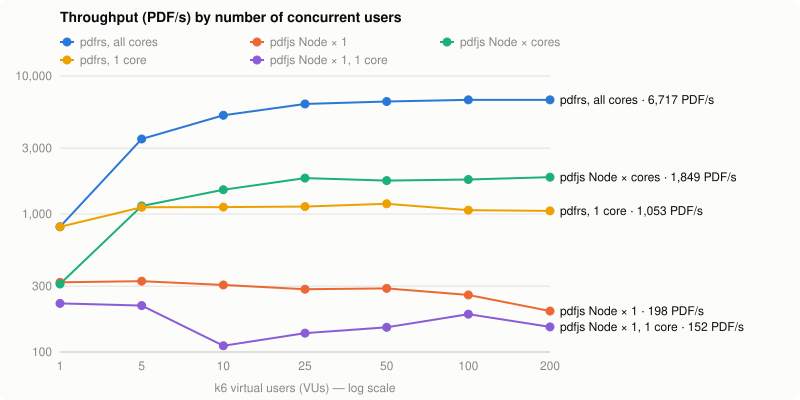
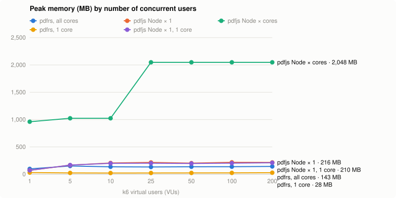

# pdfrs

Generates PDFs from HTML/CSS, **without a browser**: a Rust port of [`@gouz/pdfjs`](https://github.com/gouz/pdfjs), shipped as a small HTTP API in a ~20 MB Docker image, **~4.5× faster per core and ~7× leaner in memory** (see [Performance](#performance)).

- HTML parsing by [html5ever](https://github.com/servo/html5ever) (Servo's parser), CSS selectors by [`selectors`](https://crates.io/crates/selectors)
- Layout by [Taffy](https://github.com/DioxusLabs/taffy): block (with margin collapsing), flexbox, **grid**, float — the counterpart of Yoga in react-pdf
- Text by [Parley](https://github.com/linebender/parley): shaping, Unicode line breaking, justification, per-character font fallback
- PDF by [krilla](https://github.com/LaurenzV/krilla) (Typst's PDF engine): subset embedded fonts, selectable text, clickable links

## Getting started

```bash
docker run -p 3000:3000 ghcr.io/gouz/pdfrs:main
# or from source
docker build -t pdfrs . && docker run -p 3000:3000 pdfrs
```

The image (amd64 and arm64) is published by CI ([`.github/workflows/ci.yml`](.github/workflows/ci.yml)): `:main` and `:sha-xxxxxxx` on every push to `main`, `:1.2.3`, `:1.2` and `:latest` for a `v1.2.3` tag. Pull requests run the tests and build the image without publishing it.

```bash
# raw HTML in the body, options in the query string
curl --data-binary @invoice.html 'http://localhost:3000/?size=A4&margin=40' -o invoice.pdf

# or as JSON
curl -H 'content-type: application/json' \
  -d '{"html": "<h1>Hello</h1>", "footer": "<p style=\"text-align:right\">{page} / {pages}</p>"}' \
  http://localhost:3000/ -o hello.pdf
```

| Route | |
|---|---|
| `POST /` or `POST /pdf` | body: the HTML (`text/html`, or anything), or `{"html": …, …options}` (`application/json`). Response: `application/pdf` |
| `GET /health` | `ok` |
| `GET /` | usage |

Errors: `400` for an invalid option (the message says which one), `500` if rendering fails.

### Options

As query parameters or JSON fields:

| Option | Example | |
|---|---|---|
| `size` | `A5`, `LETTER`, `400x600` | page size (`A4` by default, `A3`, `A6`, `B5`, `LEGAL`, `TABLOID`, or `WIDTHxHEIGHT` in pt) |
| `landscape` | `true` | landscape orientation |
| `margin` | `40`, `60 40 50 40` | margins in pt (40 by default), CSS order top right bottom left, commas accepted |
| `font` | `Times-Roman` | default font (`Helvetica` by default) |
| `fontSize` | `11` | default size (12) |
| `header` | `<p>Report</p>` | header repeated on every page, vertically centered in the top margin |
| `footer` | `<p>{page} / {pages}</p>` | footer repeated on every page |
| `title`, `author`, `subject`, `keywords` | | PDF metadata (`title` falls back to `<title>`) |

### Environment variables

| Variable | Default | |
|---|---|---|
| `PORT` | `3000` | |
| `WORKERS` | number of cores | render threads; extra requests wait their turn |
| `FONTS_DIR` | `/fonts` | font directories (`.ttf`, `.otf`, `.ttc`, recursive), separated by `:` |
| `IMAGES_DIR` | — | directory for local images, see [Images](#images) |
| `MAX_BODY_MB` | `20` | maximum request size |

## Command line

The same binary converts a file:

```bash
cargo run --release -- invoice.html invoice.pdf --size A5 --footer '<p>{page} / {pages}</p>'
# or inside the image
docker run --rm -v "$PWD":/w -w /w --entrypoint /pdfrs pdfrs invoice.html invoice.pdf
```

Options: `--size`, `--landscape`, `--margin`, `--font`, `--font-size`, `--header`, `--footer`, `--title`. Local images are allowed from the HTML file's folder.

## Fonts

The image ships **Liberation Sans / Serif / Mono**, metric-compatible with Helvetica / Times / Courier (a document takes the same space as with pdfjs), and **DejaVu Sans** as a fallback for missing characters (arrows, symbols, Greek, Cyrillic…).

- `Helvetica`, `Arial`, `sans-serif`, `system-ui` → Liberation Sans; `Times-Roman`, `serif` → Liberation Serif; `Courier`, `monospace` → Liberation Mono.
- As in a browser, a stack like `font-family: "Segoe UI", Roboto, sans-serif` uses the first available font. If none is available, the declaration is ignored and the parent's font applies.
- To add fonts, mount them into the container: `docker run -v ./fonts:/fonts/extra pdfrs` (all of `FONTS_DIR` is scanned). They are usable by family name, in CSS as well as in the `font` option. Bold and italic use the family's matching files when they exist.
- No CJK font in the image: add for example Noto Sans CJK to `FONTS_DIR` for Chinese, Japanese or Korean.

## Images

The HTML may come from an untrusted source, so **by default only `data:` images are loaded**.

| Source | Allowed if… |
|---|---|
| `data:image/...` | always |
| `logo.png`, `img/a.jpg` | `IMAGES_DIR` is set and the file is **inside** that directory (`../`, absolute paths and symlinks pointing outside are refused) |
| `https://...` | never: rendering makes no network requests (inline the image as `data:`) |
| `file://`, others | never |

```bash
docker run -p 3000:3000 -v ./templates/img:/images:ro -e IMAGES_DIR=/images pdfrs
```

A refused or missing image is not displayed and a warning is written to stderr.

Formats: PNG, JPEG, GIF, WebP and SVG (in `` or inline `<svg>…</svg>` in the HTML). An image without a size keeps its natural size (1 px = 1 pt), without exceeding the available width; `width` / `height` (attributes or CSS) are honored, keeping the aspect ratio when only one is given. `object-fit` and `border-radius` are supported.

## Supported CSS

As in pdfjs, **1 px = 1 pt**.

- **Layout**: `display` `block` / `flex` / `grid` / `none` / `contents` / `list-item` / `table…`, margins that collapse like in a browser, `float` / `clear`, `position: absolute` (relative to the parent).
- Full **flexbox**: `flex-direction`, `flex-wrap`, `flex` / `flex-grow` / `flex-shrink` / `flex-basis`, `justify-content`, `align-items`, `align-self`, `align-content`, `gap`, `order`.
- **Grid**: `grid-template-columns` / `-rows` (`fr`, `repeat()`, `minmax()`, `auto`…), `grid-column` / `grid-row`, `grid-auto-flow`, `gap`, `justify-items`, `place-items`…
- **Boxes**: `width` / `height` (+ `min-` / `max-`), `box-sizing`, `margin`, `padding`, `border` (width, `solid` / `dashed` / `dotted`, color per side), `border-radius`, `background-color` (or the color of `background`), `opacity`, `overflow: hidden`, `aspect-ratio`.
- **Text**: `font` / `font-family` / `font-size` / `font-weight` / `font-style`, `color`, `text-align` (including `justify`), `line-height`, `text-decoration`, `text-transform`, `letter-spacing`, `word-spacing`, `white-space` (`pre`, `nowrap`…), background of inline elements (`<mark>`, `<span style="background">`).
- **Units**: `px`, `pt`, `em`, `rem`, `%`, `mm`, `cm`, `in`, `pc`. Colors: names, `#hex`, `rgb()`, `hsl()`…
- **Pagination**: automatic page breaks between lines of text (never through a line or an image), `page-break-before` / `-after: always` (or `break-before: page`), `page-break-inside: avoid`.
- **HTML**: tables (grid with `colspan` / `rowspan`, `border-collapse`, `border-spacing`, `vertical-align`), lists (`disc`, `circle`, `square`, `decimal`, `lower-alpha`, `upper-roman`…, `<ol start>`, `<li value>`), clickable links (`http(s):`, `mailto:`, `tel:`), `<br>`, `<pre>`, `<svg>`, browser default styles (`h1`…`h6`, `b`, `i`, `code`…), `align` / `bgcolor` attributes.
- `<style>` with all CSS selectors (`>`, `+`, `~`, `:first-child`, `:nth-child()`, `[attr]`, `:not()`…), specificity and `!important`.

**Not supported**: `background-image` and gradients, `box-shadow`, `transform`, pseudo-elements (`::before`), `@media`, `@font-face` (mount fonts into `FONTS_DIR`), `@page`, external `<link>` stylesheets, CSS variables `var()`, `calc()`, `inline-block` (treated as `inline`: text keeps flowing, padding and border ignored), images in the middle of a line of text (they go on their own line), text wrapping around a `float`, repeating `<thead>` on every page, right-to-left text (untested).

**Differences from pdfjs**:
- Vertical margins collapse like in a browser (react-pdf adds them up): paragraphs are slightly tighter.
- No infinite loop or crash on a `min-height` taller than the page, `gap: normal`, `border: medium` or an unknown font: nothing to work around.
- No remote images.

## Performance

Measured with [k6](https://k6.io), same scenario as pdfjs (`bench/k6.js`: POST the three documents in `demo/` in turn, PDF response). **Everything runs in Docker on the same VM** (12 CPUs, k6 included) for a like-for-like comparison: pdfrs in its image, pdfjs 1.1.0 with `bench/server.ts` on `node:26-alpine` (`NODE_ENV=production`, `--max-old-space-size=128`). Each stage lasts 15 s; memory is the server container's peak (`docker stats`, rounded to the nearest GB above 1 GB).





| Server | Max throughput | p95 at 10 VUs | p95 at 200 VUs | Memory at 200 VUs | Errors |
|---|---|---|---|---|---|
| **pdfrs, 12 threads** | **6,912 PDF/s** | **4 ms** | **36 ms** | 143 MB | 0 % |
| pdfjs, Node × 12 (cluster) | 1,957 PDF/s | 12 ms | 232 ms | ~2 GB | 0 % |
| pdfjs, Node × 1 | 339 PDF/s | 41 ms | 1,735 ms | 216 MB | 0 % |
| **pdfrs, 1 core** (`--cpus 1`, `WORKERS=1`) | **1,210 PDF/s** | 15 ms | 246 ms | **28 MB** | 0 % |
| pdfjs, Node × 1 on 1 core | 266 PDF/s | 70 ms | 3,783 ms | 210 MB | 0 % |

- **Core for core, pdfrs renders ~4.5× more PDFs than pdfjs, with ~7× less memory.** On the whole machine: ~3.5× the throughput of clustered Node, for ~15× less memory.
- Rendering is CPU-bound: render threads (`WORKERS`, one per core by default) work in parallel within a single process, without duplicating fonts or the runtime; extra requests wait their turn, so latency rises without losing throughput.
- Under load, Node × 1 loses throughput (GC) as the queue grows; pdfrs stays stable.
- The image sets `MIMALLOC_PURGE_DELAY=0` and `MIMALLOC_ARENA_EAGER_COMMIT=0`: the allocator returns freed memory right away (−50 % memory under load, same throughput).
- Container startup: a few milliseconds; 20 MB image (static binary + 14 fonts), ~25 MB of memory at idle.

To reproduce (Docker is enough, with pdfjs cloned alongside):

```bash
PDFJS_DIR=../pdfjs sh bench/sweep.sh > bench/results.csv   # ~10 min: rs, js1, jsN, rs1, js1c
node bench/chart.ts                                         # → bench/chart.svg, memory.svg, latency.svg
```

## Development

No need for Rust locally: everything runs in Docker.

```bash
# dev container, cargo caches in volumes
docker run -d --name pdfrs-dev -v "$PWD":/src -v pdfrs-cargo:/usr/local/cargo/registry -v pdfrs-target:/src/target \
  -w /src rust:alpine sleep infinity
docker exec pdfrs-dev apk add musl-dev font-liberation font-dejavu
docker exec pdfrs-dev cargo test
docker exec pdfrs-dev cargo run --release -- demo/report.html report.pdf
```

With Rust installed, `cargo test` and `cargo run` work the same way, with `FONTS_DIR` pointing to a font directory.

| File | |
|---|---|
| `src/css.rs` | stylesheets, declarations, specificity, cascade |
| `src/style.rs` | computed style: inheritance, units, shorthands (`margin`, `border`, `flex`, `font`…) |
| `src/layout.rs` | DOM → Taffy box tree, Parley text, tables as grids, lists, images |
| `src/render.rs` | pagination and krilla drawing (backgrounds, borders, text, images, SVG, links) |
| `src/lib.rs` | `html_to_pdf(html, &Options)`: pages, header / footer, metadata |
| `src/main.rs` | HTTP server (axum) and command line |

## License

[MIT](LICENSE)
